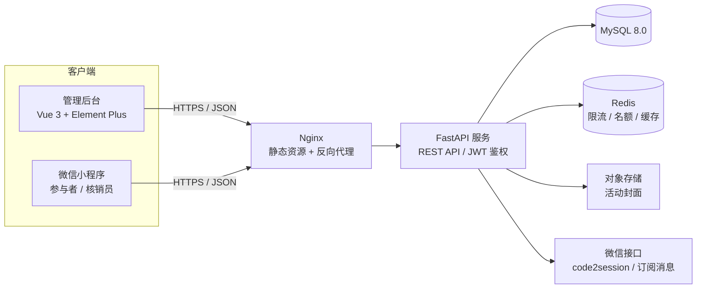
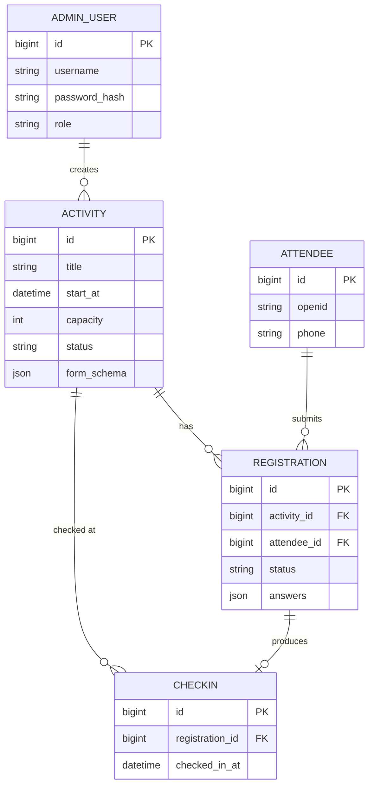

# 活动报名与签到管理系统 — 产品与技术规划

> 文档版本：v1.1（规划稿，2026-10-24 更新）  
> 定位：单机构、多活动，管理后台 + 参与者网页版 / 微信小程序，二维码核销  
> 技术栈：Vue 3 + FastAPI + MySQL  
> 说明：本文档描述目标形态；文中标注为“当前”的能力以代码与 [README.md](README.md) 为准。

---

## 1. 一页纸概要

### 1.1 系统是什么

一个面向单个组织（学校、公司、社群、协会）的活动管理平台，解决从“发布活动 → 收集报名 → 审核名单 → 现场签到 → 数据统计”的完整闭环。

### 1.2 核心用户

| 用户 | 使用端 | 主要诉求 |
| --- | --- | --- |
| 活动组织者 / 管理员 | PC 管理后台 | 发布活动、配置报名表、管理名单、查看数据 |
| 参与者 | 微信小程序 | 浏览活动、报名、查看电子票、接收通知 |
| 现场工作人员 | 微信小程序（核销模式） | 扫码签到、处理异常、查看实时到场情况 |

### 1.3 MVP 核心闭环

```
创建活动 → 配置报名表单/名额/时间 → 发布
    → 用户小程序报名（可选审核）→ 获得电子票二维码
    → 现场工作人员扫码核销 → 签到成功
    → 后台查看名单/签到率 → 导出 Excel
```

### 1.4 首版不做的内容

- 在线支付 / 报名费
- 多主办方入驻（多租户）
- 人脸识别签到
- 复杂审批流、多级组织架构
- 短信群发（首版站内通知 + 可选订阅消息）

这些能力在数据模型和模块划分上预留扩展点，但不进入首版范围。

---

## 2. 目标与范围

### 2.1 产品目标

1. 管理员无需开发人员介入即可独立创建活动、配置报名表单。
2. 参与者报名路径不超过 3 步，报名后能随时查看电子票。
3. 现场签到达成“扫码 1 秒完成、重复签到有提示、断网有兜底”。
4. 活动结束后可直接导出完整名单与签到数据，无需手工整理。

### 2.2 范围边界

- 单机构：所有数据属于同一个组织，不做数据隔离。
- 多活动：支持同时存在多个进行中活动，活动之间名额、名单、统计相互独立。
- 单场次：一个活动对应一个签到时间窗；多场次（如上午场/下午场）列为二期。
- 报名主体：一个微信用户对应一条报名记录，不做“一人代报多人”（二期）。

---

## 3. 角色与权限

| 角色 | 说明 | 权限 |
| --- | --- | --- |
| 超级管理员 | 系统负责人 | 全部功能、管理员账号管理、系统设置 |
| 活动管理员 | 日常运营人员 | 活动的增删改查、发布、名单管理、审核、导出、统计 |
| 核销员 | 现场工作人员 | 仅扫码核销、名单检索、查看现场签到情况 |
| 参与者 | 小程序用户 | 浏览活动、报名/取消、查看电子票、查看通知 |

### 权限模型

- 首版采用 **RBAC + 角色枚举**：`super_admin` / `operator` / `staff`。
- `staff`（核销员）为 v0.3 扫码核销预留：当前后端接口只校验 `super_admin` 与 `operator`，核销功能尚未实现。
- 核销员通过“后台创建账号 → 小程序绑定”获得身份，或在后台生成核销邀请码。
- 二期可扩展为“按活动授权”（`admin_activity` 关联表），支持不同活动由不同同事负责。

---

## 4. 功能清单

### 4.1 管理后台（Vue 3）

#### 4.1.1 登录与账号

- 账号密码登录、退出、修改密码
- 管理员列表：新增、禁用、重置密码、分配角色（超级管理员）
- 登录失败次数限制、操作日志

#### 4.1.2 活动管理

- 活动列表：按状态（草稿/已发布/已结束/已下架）、时间、关键词筛选
- 创建/编辑活动，字段包括：
  - 基础信息：标题、封面图、活动简介、详情（富文本或 Markdown）
  - 时间信息：活动开始/结束时间、报名开始/截止时间、签到开放/关闭时间
  - 地点信息：地点名称、详细地址（二期可加经纬度用于定位签到）
  - 名额与规则：总名额、是否需要审核、是否允许取消、报名信息是否可修改
  - 报名表单：系统字段（姓名、手机号）+ 自定义字段配置
- 发布 / 下架 / 结束 / 复制活动
- 活动预览（管理员视角查看小程序端效果）

#### 4.1.3 报名表单设计器

- 字段类型：单行文本、多行文本、手机号、邮箱、数字、单选、多选、下拉、日期
- 字段配置：标签、占位提示、是否必填、选项、排序
- 系统内置字段：姓名（必填）、手机号（必填，可配置是否显示）
- 表单结构以 JSON Schema 形式保存，小程序端动态渲染，后端按同一 Schema 校验
- 首版提供列表式可视化编辑，不做拖拽

#### 4.1.4 名单与审核

- 报名名单：分页、按状态/关键词（姓名、手机号）筛选
- 审核通过 / 拒绝 / 批量审核；拒绝时填写原因
- 管理员手动添加报名（代报名）、取消报名、修改报名信息
- 导出 Excel（姓名、手机号、报名时间、审核状态、签到时间、自定义字段）
- 报名详情：完整表单内容、电子票状态、签到记录、操作记录

#### 4.1.5 签到核销

- 现场实时数据：已报名、已通过、已签到、签到率、最近签到记录
- 核销方式：小程序扫码（主方式）
- 名单检索核销（建议纳入首版，作为现场兜底，约 0.5 天工作量）
- 重复签到提示：显示“已于 14:03 签到”，不重复写入
- 签到时间窗校验：不在开放时间内给出明确提示，可由管理员强制签到
- 撤销签到（管理员权限，记录操作人）

#### 4.1.6 数据统计

- 核心指标：报名数、审核通过数、签到数、签到率、取消数
- 报名趋势：按天统计新增报名
- 签到时间分布：按小时统计
- 二期：浏览量、转化率、渠道来源、报名表单字段分布

#### 4.1.7 通知与消息

- 首版：小程序站内消息中心（报名成功、审核结果、活动提醒）
- 二期：微信订阅消息（需逐次授权）、短信通知、邮件通知
- 管理员可手动向某活动全部/部分参与者发送站内通知

#### 4.1.8 系统设置

- 机构名称、Logo、默认活动封面
- 报名须知 / 隐私政策模板
- 管理员账号管理、操作日志查询

### 4.2 微信小程序（参与者端）

- 微信登录（静默 `wx.login`，首次授权头像昵称）
- 首页：活动列表（进行中/即将开始/已结束）、搜索、轮播推荐
- 活动详情：封面、时间、地点、名额余量、报名状态、详情内容
- 报名：动态渲染报名表单、校验必填项、提交、报名结果页
- 我的报名：报名状态、审核结果、取消报名（在允许时间内）
- 电子票：活动信息 + 签到二维码 + 报名编号，支持亮度调高
- 消息中心：报名成功、审核结果、活动提醒、管理员通知
- 个人中心：头像昵称、手机号、报名历史

### 4.3 微信小程序（工作人员核销模式）

- 工作人员登录后可见“核销”入口（普通参与者不可见）
- 扫码核销：调用 `wx.scanCode`，识别用户电子票，提交后端
- 核销结果：成功显示参与者姓名 + 报名信息；失败提示具体原因（已签到/已取消/活动不匹配/未通过审核）
- 手动检索核销：输入姓名或手机号后四位，确认后签到
- 签到统计：实时显示本场已签到人数和最近记录
- 现场网络异常时：本地缓存操作结果，恢复后重试（首版可先做失败重试提示）

### 4.4 二期功能池（按优先级）

1. 微信订阅消息（报名成功、活动开始前提醒）
2. 多场次活动、候补名单与自动递补
3. 按活动授权管理员、核销员邀请码
4. 报名费支付与退款
5. 定位签到（地理围栏）
6. 签到大屏 / 现场投屏
7. 一人代多人报名（家庭票/团队票）
8. 黑名单、报名问卷统计分析、活动复制模板
9. 多租户 SaaS 化

---

## 5. 核心业务流程

### 5.1 活动发布

```
管理员登录 → 创建活动（草稿）→ 配置基础信息/时间/名额/报名表
→ 预览 → 发布 → 小程序活动列表可见 → 到达报名开始时间自动开放
```

- 活动状态机：`draft → published → finished`，任意状态可 `closed`（下架）。
- 报名开放由「活动已发布 + 当前时间在报名窗口内 + 名额未满」共同决定，不额外维护状态。

### 5.2 报名

```
用户登录小程序 → 进入活动详情 → 点击报名
→ 前端校验（登录/时间窗/余量/重复报名）
→ 后端事务内再次校验 → 校验表单 Schema → 创建报名记录
→ 若无需审核：status=approved，可查看电子票
→ 若需审核：status=pending，等待管理员处理
→ 名额占用的处理见 8.3
```

业务规则：

- 同一用户对同一活动只能有一条报名记录；取消后可重新报名（复用原记录，重置状态）。
- 报名截止后不可新报名；取消截止时间可单独配置，默认与报名截止一致。
- 审核拒绝后，可在报名截止前修改信息重新提交（二期）或直接重新报名（首版）。
- 名额已满时返回明确的“名额已满”，不进入候补（二期）。

### 5.3 审核

```
管理员在后台筛选 pending 报名 → 查看表单内容 → 通过/拒绝
→ 更新状态并记录审核人/时间/原因 → 写入站内通知
```

- 批量审核仅对 `pending` 记录生效。
- 拒绝不占用名额（名额在报名创建时占用，拒绝时释放，见 8.3）。

### 5.4 现场签到

```
工作人员打开小程序核销页 → 扫描参与者电子票二维码
→ 后端校验：token 签名 → 报名记录存在 → 活动匹配 → 状态为 approved
→ 校验签到时间窗 → 检查是否已签到
→ 写入签到记录（操作人、方式、时间、设备）
→ 返回参与者姓名与签到结果，小程序展示
```

- 电子票二维码内容为签名 token，不暴露可枚举的数据库 ID。
- 签到成功后二维码仍然存在，但再次扫描会提示已签到并显示原签到时间。
- 管理员可在后台撤销签到，需填写原因并记录日志。

### 5.5 取消报名与名额释放

```
用户在允许时间内取消 → status=cancelled → 释放名额 → 电子票失效
```

- 已签到用户不允许自行取消（后台可撤销签到后再处理）。
- 活动开始后默认不允许取消，可由管理员配置。

---

## 6. 技术架构

### 6.1 技术选型

| 层次 | 选型 | 说明 |
| --- | --- | --- |
| 管理后台 | Vue 3 + Vite + TypeScript | 组合式 API |
| UI 组件 | Element Plus | 后台管理生态成熟 |
| 状态管理 | Pinia + Vue Router | 轻量、官方推荐 |
| 图表 | ECharts | 统计看板 |
| 小程序 | 原生微信小程序（当前为手写，未引入 TDesign） | 稳定、微信能力接入直接；若希望复用 Vue 语法可换 uni-app，后端接口不变 |
| 后端 | Python 3.12+（本地 3.13、镜像 3.12）+ FastAPI | 异步、自动 OpenAPI 文档 |
| ORM / 迁移 | SQLAlchemy 2.0 + Alembic | 异步驱动 |
| 数据库 | MySQL 8.4（utf8mb4） | 本地开发默认 SQLite；国内部署常见 MySQL；如偏好 PostgreSQL 也可平滑替换 |
| 缓存 | Redis 7（规划，当前未启用） | 限流、名额缓存、会话辅助；当前登录限流为进程内内存实现，多 worker 部署前需替换 |
| 鉴权 | JWT（PyJWT） | 后台与小程序统一 |
| 密码哈希 | Argon2 或 bcrypt | 不存明文 |
| Excel | openpyxl | 名单导出 |
| 二维码 | 后端生成 PNG（当前实现）；小程序 canvas 可选 | 内容为签名 token |
| 文件存储 | 阿里云 OSS / 腾讯云 COS | 活动封面；首版也可本地存储 + Nginx 静态托管 |
| 部署 | Docker Compose + Nginx + Uvicorn | 单机起步，便于迁移 |
| 测试 | pytest + httpx AsyncClient | 接口级测试，当前 56 个用例 |

> 本表是规划阶段的选型，部分能力尚未落地。已落地：Vue 3 + Element Plus + FastAPI + SQLAlchemy 2.0 + MySQL 8.4；未启用：Redis、TDesign、对象存储、ECharts（统计图表在 v0.3 实现）。

### 6.2 系统架构



### 6.3 项目结构

```
event-system/
├── backend/
│   ├── app/
│   │   ├── main.py
│   │   ├── api/
│   │   │   ├── admin/          # 后台接口
│   │   │   ├── mp/             # 小程序接口
│   │   │   └── deps.py         # 鉴权依赖
│   │   ├── core/               # 配置、安全、异常、日志
│   │   ├── models/             # SQLAlchemy 模型
│   │   ├── schemas/            # Pydantic 模型
│   │   ├── services/           # 业务逻辑（报名、核销、导出）
│   │   └── utils/
│   ├── alembic/
│   ├── tests/
│   ├── pyproject.toml
│   └── Dockerfile
├── admin-web/
│   ├── src/
│   │   ├── api/
│   │   ├── views/
│   │   ├── components/
│   │   ├── stores/
│   │   ├── router/
│   │   └── utils/
│   └── vite.config.ts
├── miniprogram/
│   ├── pages/
│   │   ├── index/              # 活动列表
│   │   ├── activity/           # 活动详情
│   │   ├── signup/             # 报名
│   │   ├── mine/               # 我的报名
│   │   ├── ticket/             # 电子票
│   │   ├── checkin/            # 核销（工作人员）
│   │   └── messages/           # 消息中心
│   ├── components/
│   └── utils/
├── docs/
├── docker-compose.yml
└── README.md
```

> 目录为规划示意，实际结构以 [README.md](README.md) 的「目录结构」为准：小程序是 `app.js` + `pages/<name>/index.*` 的平铺结构，参与者网页版是独立的 `web-app/`。

---

## 7. 数据模型

### 7.1 实体关系



### 7.2 表设计

#### admin_user — 后台账号

| 字段 | 类型 | 说明 |
| --- | --- | --- |
| id | BIGINT PK | 自增 |
| username | VARCHAR(64) UNIQUE | 登录名 |
| password_hash | VARCHAR(255) | Argon2/bcrypt |
| display_name | VARCHAR(64) | 姓名 |
| phone | VARCHAR(20) | 用于小程序身份绑定 |
| role | ENUM | super_admin / operator / staff |
| status | TINYINT | 1 正常 / 0 禁用 |
| last_login_at | DATETIME | |
| created_at / updated_at | DATETIME | |

#### attendee — 小程序用户

| 字段 | 类型 | 说明 |
| --- | --- | --- |
| id | BIGINT PK | |
| openid | VARCHAR(64) UNIQUE | 小程序内唯一 |
| unionid | VARCHAR(64) NULL | 预留 |
| nickname | VARCHAR(64) | |
| avatar_url | VARCHAR(500) | |
| phone | VARCHAR(20) NULL | 报名时补全或微信授权 |
| created_at / last_login_at | DATETIME | |

#### activity — 活动

| 字段 | 类型 | 说明 |
| --- | --- | --- |
| id | BIGINT PK | |
| title | VARCHAR(200) | |
| cover_url | VARCHAR(500) | |
| summary | VARCHAR(500) | 列表摘要 |
| description | MEDIUMTEXT | 详情 |
| location_name | VARCHAR(200) | 场地名称 |
| address | VARCHAR(500) | 详细地址 |
| start_at / end_at | DATETIME | 活动时间 |
| signup_start_at / signup_end_at | DATETIME | 报名窗口 |
| checkin_open_at / checkin_close_at | DATETIME | 签到窗口 |
| capacity | INT | 总名额 |
| taken_count | INT | 已占用名额（含 pending） |
| need_review | BOOLEAN | 是否需要审核 |
| allow_cancel | BOOLEAN | 是否允许取消 |
| cancel_deadline | DATETIME NULL | 取消截止 |
| form_schema | JSON | 报名表单定义 |
| status | ENUM | draft / published / finished / closed |
| created_by | BIGINT FK | |
| published_at | DATETIME NULL | |
| created_at / updated_at | DATETIME | |

索引：`(status, start_at)`、`(created_by)`。

#### registration — 报名记录

| 字段 | 类型 | 说明 |
| --- | --- | --- |
| id | BIGINT PK | |
| activity_id | BIGINT FK | |
| attendee_id | BIGINT FK | |
| status | ENUM | pending / approved / rejected / cancelled |
| answers | JSON | 表单答案（键为字段 key） |
| applicant_name | VARCHAR(64) | 冗余，便于检索/导出 |
| applicant_phone | VARCHAR(20) | 冗余，便于检索/导出 |
| reviewed_by | BIGINT NULL | |
| reviewed_at | DATETIME NULL | |
| review_note | VARCHAR(500) NULL | |
| cancelled_at | DATETIME NULL | |
| created_at / updated_at | DATETIME | |

约束与索引：

- `UNIQUE(activity_id, attendee_id)`：同一活动同一用户唯一（取消后重用该记录）。
- `INDEX(activity_id, status, created_at)`：名单筛选。
- `INDEX(attendee_id)`：我的报名。
- `INDEX(applicant_phone)`：现场手机号检索。

#### checkin — 签到记录

| 字段 | 类型 | 说明 |
| --- | --- | --- |
| id | BIGINT PK | |
| registration_id | BIGINT UNIQUE FK | 一报名一签到 |
| activity_id | BIGINT FK | 冗余，便于统计 |
| operator_id | BIGINT FK | 核销员 |
| method | ENUM | qrcode / manual / force |
| checked_in_at | DATETIME | |
| client_info | VARCHAR(255) | 设备/网络信息 |
| ip | VARCHAR(45) | |
| created_at | DATETIME | |

索引：`(activity_id, checked_in_at)`。

> 撤销签到采用物理删除 + `audit_log` 留痕，或增加 `revoked_at` 软删除字段（推荐后者，便于追溯）。

#### notification — 站内通知

| 字段 | 类型 | 说明 |
| --- | --- | --- |
| id | BIGINT PK | |
| attendee_id | BIGINT FK | 接收人 |
| activity_id | BIGINT NULL | 关联活动 |
| type | VARCHAR(32) | signup_success / review_result / reminder / system |
| title / content | VARCHAR | |
| read_at | DATETIME NULL | |
| created_at | DATETIME | |

索引：`(attendee_id, read_at, created_at)`。

#### audit_log — 操作日志

| 字段 | 类型 | 说明 |
| --- | --- | --- |
| id | BIGINT PK | |
| admin_id | BIGINT NULL | |
| action | VARCHAR(64) | 如 activity.publish、checkin.revoke |
| target_type / target_id | VARCHAR / BIGINT | |
| detail | JSON | 变更前后关键字段 |
| ip | VARCHAR(45) | |
| created_at | DATETIME | |

索引：`(created_at)`、`(target_type, target_id)`。

### 7.3 名额扣减策略

核心原则：**报名创建与名额扣减必须在同一数据库事务内完成，且使用条件更新避免超卖。**

```sql
UPDATE activity
SET taken_count = taken_count + 1
WHERE id = :activity_id
  AND status = 'published'
  AND taken_count < capacity;
-- 受影响行数为 0，说明名额已满或活动状态变化，报名失败
```

- 审核拒绝、取消报名、管理员取消时执行 `taken_count - 1`，并确保不小于 0。
- 不使用“先查余量再插入”的两步判断，避免并发超卖。
- Redis 缓存余量仅用于展示，最终以数据库条件更新为准。

### 7.4 签到码设计

- 不直接在二维码中放报名 ID，避免被枚举或伪造。
- 采用 HMAC 签名 token：payload 为 `<registration_id>.<activity_id>`，token 为 `base64url(payload)` + `.` + `HMAC-SHA256(TICKET_SECRET, payload)` 的前 32 位十六进制，可确定性生成、无需落库（实现见 `backend/app/core/ticket.py`）。
- 后端校验：签名正确 → 查到报名记录 → 活动与 token 中活动 ID 一致 → 状态为 approved → 未签到 → 在签到窗口内。
- 撤销报名/取消后，状态校验自然拦截；签名密钥轮换会使旧票失效（需评估）。
- 二期可升级为动态二维码（短时效 token），首版静态码 + 现场人工核验足够。

---

## 8. API 设计概览

统一前缀：`/api`。响应结构：

```json
{
  "code": 0,
  "message": "ok",
  "data": {}
}
```

分页参数：`page`、`page_size`；分页响应：`items`、`total`、`page`、`page_size`。

### 8.1 管理后台接口

| 方法 | 路径 | 说明 |
| --- | --- | --- |
| POST | /admin/auth/login | 账号密码登录 |
| POST | /admin/auth/refresh | 刷新 Token（规划，当前未实现；Token 有效期 8 小时） |
| GET | /admin/auth/me | 当前账号信息 |
| PUT | /admin/auth/password | 修改密码 |
| GET | /admin/admins | 管理员列表 |
| POST | /admin/admins | 新增管理员 |
| PATCH | /admin/admins/{id} | 禁用/重置密码/改角色 |
| GET | /admin/activities | 活动列表（筛选、分页） |
| POST | /admin/activities | 创建活动 |
| GET | /admin/activities/{id} | 活动详情 |
| PUT | /admin/activities/{id} | 编辑活动 |
| DELETE | /admin/activities/{id} | 删除草稿 |
| POST | /admin/activities/{id}/publish | 发布 |
| POST | /admin/activities/{id}/close | 下架 |
| POST | /admin/activities/{id}/finish | 结束 |
| POST | /admin/activities/{id}/duplicate | 复制活动 |
| POST | /admin/uploads | 上传封面图 |
| GET | /admin/activities/{id}/registrations | 报名名单 |
| POST | /admin/activities/{id}/registrations | 手动添加报名 |
| GET | /admin/registrations/{id} | 报名详情 |
| PATCH | /admin/registrations/{id} | 修改报名信息/状态 |
| POST | /admin/registrations/{id}/review | 审核通过/拒绝 |
| POST | /admin/registrations/batch-review | 批量审核 |
| POST | /admin/registrations/{id}/cancel | 管理员取消报名 |
| GET | /admin/activities/{id}/registrations/export | 导出 Excel |
| POST | /admin/checkins/scan | 扫码核销 |
| POST | /admin/checkins/manual | 手动检索核销 |
| POST | /admin/checkins/{id}/revoke | 撤销签到 |
| GET | /admin/activities/{id}/checkins | 签到记录 |
| GET | /admin/activities/{id}/stats | 统计看板 |
| GET | /admin/activities/{id}/registrations/trend | 报名趋势 |
| POST | /admin/activities/{id}/notifications | 群发站内通知 |
| GET | /admin/audit-logs | 操作日志 |

### 8.2 小程序接口

| 方法 | 路径 | 说明 |
| --- | --- | --- |
| POST | /mp/auth/login | `code2session` 登录，返回 JWT |
| PUT | /mp/auth/profile | 更新头像昵称 |
| GET | /mp/activities | 已发布活动列表 |
| GET | /mp/activities/{id} | 活动详情（含余量、我的报名状态） |
| POST | /mp/activities/{id}/registrations | 提交报名 |
| GET | /mp/registrations | 我的报名列表 |
| GET | /mp/registrations/{id} | 报名详情（含电子票 token） |
| PATCH | /mp/registrations/{id} | 修改报名信息（允许时） |
| POST | /mp/registrations/{id}/cancel | 取消报名 |
| GET | /mp/notifications | 消息列表 |
| POST | /mp/notifications/{id}/read | 标记已读 |
| POST | /mp/checkin/scan | 工作人员扫码核销 |
| GET | /mp/checkin/stats?activity_id= | 现场签到统计 |
| GET | /mp/staff/activities | 我可核销的活动 |

### 8.3 鉴权

- 管理后台与小程序各自使用独立 JWT 受众（`aud`），互不通用。
- JWT 载荷：`sub`（用户 ID）、`role`、`type`（admin/attendee）、`exp`。
- 后台 Token 有效期 8 小时；小程序 Token 7 天，可静默续期。
- 核销接口需 `role in (super_admin, operator, staff)`，并校验对该活动有权限（首版仅校验角色）。

---

## 9. 关键设计决策

### 9.1 动态报名表单

`form_schema` 示例：

```json
[
  { "key": "name", "label": "姓名", "type": "text", "required": true, "system": true },
  { "key": "phone", "label": "手机号", "type": "phone", "required": true, "system": true },
  { "key": "company", "label": "单位", "type": "text", "required": false },
  { "key": "diet", "label": "饮食偏好", "type": "select", "required": false, "options": ["无", "素食", "清真"] }
]
```

- 前端据此渲染，后端据此校验必填、类型、选项合法性。
- 答案存 `registration.answers` JSON；姓名/手机号额外冗余到列，便于检索、导出和索引。
- 修改表单 Schema 时，向管理员提示“已提交的报名不会重新校验”；已结束活动禁止修改。

### 9.2 微信登录与手机号

- 登录：小程序 `wx.login` 获取 code → 后端调用 `code2session` → 得到 openid → 查找/创建 attendee → 签发 JWT。
- 手机号：首版采用**用户手动填写 + 格式校验**。微信手机号快速验证组件需要企业主体且按次收费，且并非所有主体可用，不纳入首版。
- 短信验证码：二期接入阿里云/腾讯云短信，用于手机号真实性校验。

### 9.3 通知策略

| 类型 | 首版 | 二期 |
| --- | --- | --- |
| 报名成功 / 审核结果 | 站内消息中心 | 站内 + 订阅消息 |
| 活动开始提醒 | 站内（进入小程序可见） | 定时任务 + 订阅消息 |
| 管理员群发 | 站内 | 站内 + 短信 |

> 微信订阅消息为“一次性订阅”，必须在用户主动点击时请求授权，不能后台静默推送。因此站内消息是首版更可靠的通知渠道，订阅消息只作为增强。

### 9.4 文件上传

- 后端校验 MIME、扩展名、文件大小（建议 5 MB），重命名后存入 OSS 或本地目录。
- 不做任意路径写入；返回可访问 URL。
- 图片可接入 OSS 图片处理做缩略图，首版可省略。

### 9.5 Excel 导出

- 列：报名编号、姓名、手机号、报名状态、报名时间、审核结果、签到时间、签到方式、所有自定义字段。
- 使用 `openpyxl` 流式写出，避免大名单占满内存；单活动 1 万条以内无需异步任务。
- 导出操作写入 `audit_log`。

---

## 10. 非功能性要求

### 10.1 性能

- 常规接口 P95 < 500 ms（不含导出）。
- 活动列表、名单列表必须分页，默认 20 条，最大 100 条。
- 首版目标容量：单活动 5,000 人报名，同时在线核销 10 人，单机 2C4G 可支撑。

### 10.2 安全

- 密码 Argon2/bcrypt 哈希；登录接口限流（如 5 次/分钟/IP）。
- 所有写接口鉴权 + 角色校验；越权访问返回 403。
- 防止超卖、重复报名、重复签到（数据库唯一约束 + 事务）。
- 上传文件类型白名单；输出转义，富文本内容需清洗（如使用 bleach）。
- 敏感配置（数据库密码、微信 Secret、签名密钥）通过环境变量注入，不进仓库。
- 数据库每日备份，保留 7 天；上线前演练一次恢复。

### 10.3 隐私与合规

- 收集姓名、手机号前展示隐私政策并取得同意。
- 小程序需配置《用户隐私保护指引》，声明收集的信息及用途。
- 报名数据仅管理员可导出；导出行为留痕。
- 活动结束后可按机构要求定期清理或匿名化报名数据。
- 如后续增加定位签到，需单独申请位置权限并说明用途。

### 10.4 可维护性

- 后端分层：API 层只做参数校验与响应，业务逻辑放 service。
- 统一异常处理、统一响应体、请求 ID 日志。
- Alembic 管理数据库迁移，禁止手改线上表结构。
- 前端 API 类型由 OpenAPI 生成或手写类型，减少字段不一致。
- README 包含本地启动、环境变量、部署步骤。

---

## 11. 开发计划

### 11.1 里程碑（按 1 人全职估算，约 6 周）

| 阶段 | 时间 | 交付物 | 验收点 |
| --- | --- | --- | --- |
| 0. 需求与原型 | 第 1 周前半 | 页面清单、低保真原型、数据库设计、项目骨架 | 关键页面流程走通，表结构评审通过 |
| 1. 基础设施与账号 | 第 1 周后半 | Docker Compose、FastAPI 骨架、Alembic、管理员登录、JWT、小程序登录 | 后台能登录，小程序能拿到 token |
| 2. 活动管理 | 第 2 周 | 活动 CRUD、发布/下架、封面上传、表单 Schema 编辑、活动列表/详情接口 | 后台完整创建并发布一个活动，小程序可见 |
| 3. 报名闭环 | 第 3 周 | 动态表单渲染、报名提交、名额并发控制、我的报名、取消、审核、电子票 | 并发报名不超卖；取消后名额释放；重复报名被拦截 |
| 4. 签到核销 | 第 4 周 | 核销页、扫码核销、手动检索兜底、重复签到提示、撤销签到、实时统计 | 现场模拟 50 人扫码，数据准确 |
| 5. 数据与消息 | 第 5 周 | 统计看板、Excel 导出、站内通知、操作日志 | 导出的 Excel 与后台数据一致 |
| 6. 联调与上线 | 第 6 周 | 全链路测试、安全加固、部署、小程序提审、使用文档 | 小程序审核通过，真实活动跑通一次 |

> 小程序审核通常 1–7 个工作日，建议在第 5 周末提交首版审核，避免卡在上线节点。若为兼职开发，整体周期按 1.5–2 倍估算。

### 11.2 MVP 验收标准

- [ ] 管理员可创建活动、配置自定义报名字段、设置名额与时间窗并发布
- [ ] 小程序用户可微信登录、浏览活动、提交报名、查看电子票
- [ ] 报名名额在并发下不超卖，重复报名被拦截
- [ ] 需审核的活动可后台通过/拒绝，结果在小程序可见
- [ ] 用户在允许时间内可取消报名，名额正确释放
- [ ] 工作人员可扫码核销，重复签到有明确提示
- [ ] 核销失败时有手动检索兜底
- [ ] 后台可按状态/关键词筛选名单，并导出完整 Excel
- [ ] 统计页展示报名数、签到数、签到率、趋势
- [ ] 关键操作写入日志；越权接口返回 403
- [ ] 完成一次真实活动的全流程演练

> 截至 2026-10-24：第 1–5 条与第 10 条已达成；第 6、7 条与第 8 条的 Excel 导出、第 9 条的签到数与趋势属 v0.3；第 11 条目前只完成网页版演练，小程序待验收。

---

## 12. 上线前置条件

这部分需要提前办理，否则会阻塞开发联调和上线：

| 事项 | 说明 | 建议启动时间 |
| --- | --- | --- |
| 微信小程序账号 | 建议企业/组织主体；个人主体在类目和手机号能力上受限 | 第 1 周 |
| 小程序类目 | 按实际业务选择，活动报名类工具需确认主体资质要求 | 第 1 周 |
| 已备案域名 + HTTPS | 小程序 request 合法域名必须是备案域名，且为 HTTPS | 第 1 周（备案约 1–3 周） |
| 服务器 | 2C4G 起步，公网 IP，开放 80/443 | 第 2 周 |
| 对象存储（可选） | 阿里云 OSS / 腾讯云 COS，用于活动封面 | 第 2 周 |
| 隐私保护指引 | 小程序后台配置收集信息清单 | 提审前 |
| 订阅消息模板（二期） | 在小程序后台申请 | 二期前 |
| 微信支付（如需收费） | 商户号申请周期较长 | 按需提前 |

---

## 13. 风险与对策

| 风险 | 影响 | 对策 |
| --- | --- | --- |
| 小程序审核不通过 | 无法上线 | 提前确认类目与主体资质；首版功能克制，避免诱导分享、虚拟支付等敏感能力 |
| 域名备案未完成 | 小程序无法请求接口 | 第 1 周即启动备案；开发期可用内网/测试域名，提审前必须切换 |
| 现场网络差 | 扫码失败、签到排队 | 核销失败自动重试 + 手动检索兜底；核销页缓存活动名单摘要；准备 2 台核销设备 |
| 并发超卖 | 名额超限、现场冲突 | 数据库条件更新 + 唯一约束；压测 100 并发报名 |
| 重复签到 / 二维码截图传播 | 数据失真 | 报名状态校验 + 唯一签到记录；现场人工核对姓名；二期上动态码 |
| 表单字段变更导致历史数据不一致 | 导出/展示异常 | 已提交答案按提交时 Schema 解读；活动开始后禁止改表单 |
| 订阅消息触达率低 | 用户错过提醒 | 首版以站内消息为准；关键节点辅以群公告/短信（二期） |
| 管理员误操作 | 数据错误 | 关键操作二次确认、撤销签到、操作日志、每日备份 |

---

## 14. 后续演进路线

1. **增强运营**：订阅消息、活动提醒、短信、报名数据看板、渠道分析
2. **复杂活动**：多场次、候补递补、团队报名、座位/分组
3. **现场体验**：动态二维码、签到大屏、定位签到、离线核销
4. **平台化**：按活动授权、多租户、开放 API、第三方系统对接（如企业微信、学校统一身份认证）

---

## 15. 建议的下一步

1. 确认活动类型与真实使用场景（预计单场人数、是否需要审核、是否需要收费）。
2. 准备 2–3 个真实活动的字段样例，用于验证报名表单设计是否够用。
3. 按第 12 节启动小程序账号与域名备案。
4. 进入原型设计：确认后台页面清单与小程序页面清单。
5. 搭建项目骨架与数据库迁移，完成管理员登录和活动 CRUD，作为第一个可演示版本。

---

## 附录 A：后台页面清单

1. 登录页
2. 数据概览（可选）
3. 活动列表
4. 活动创建/编辑（基础信息、时间地点、名额规则、报名表单、预览）
5. 报名名单（筛选、审核、导出）
6. 报名详情
7. 签到核销（桌面端查看实时数据 + 撤销签到）
8. 签到记录
9. 统计看板
10. 通知管理
11. 管理员管理
12. 操作日志
13. 系统设置

## 附录 B：小程序页面清单

1. 首页 / 活动列表
2. 活动详情
3. 报名表单页
4. 报名结果页
5. 我的报名
6. 电子票页
7. 消息中心
8. 个人中心
9. 工作人员：核销首页
10. 工作人员：扫码结果页
11. 工作人员：手动检索页
12. 工作人员：现场签到列表
